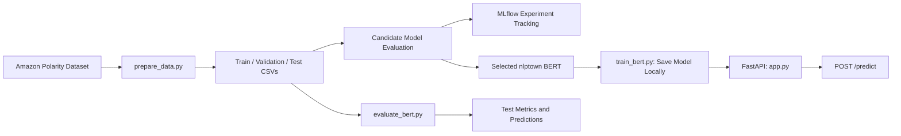

# ReviewPulse

A sentiment analysis service for Amazon product reviews. ReviewPulse prepares a reproducible dataset, evaluates pretrained BERT sentiment models, tracks model-selection experiments with MLflow, and serves the selected model through a FastAPI REST API.

**Status:** Milestone 1 — model evaluation and API implementation.

## Architecture



The API serves the selected BERT model. Model selection is based on validation-set performance. The held-out test set is reserved for final evaluation.

## Technology Stack

- **Language:** Python 3.11
- **Data processing:** pandas, NumPy, Hugging Face Datasets
- **Machine learning:** scikit-learn, PyTorch, Transformers
- **Experiment tracking:** MLflow
- **API:** FastAPI, Pydantic, Uvicorn
- **Testing and code quality:** pytest, Ruff

## Quick Start

### 1. Clone the repository

```bash
git clone https://github.com/Kashish598/ReviewPulse.git
cd ReviewPulse
```

### 2. Create and activate a virtual environment

```bash
python -m venv .venv
```

Windows:

```bash
.venv\Scripts\activate
```

macOS/Linux:

```bash
source .venv/bin/activate
```

### 3. Install dependencies

```bash
python -m pip install -r requirements.txt
```

### 4. Prepare the dataset

```bash
python -m src.prepare_data
```

This downloads the Amazon Polarity dataset from Hugging Face, cleans the review text, creates the train, validation, and test splits, and writes the processed files to `data/processed/`.

### 5. Save the selected model locally

```bash
python -m src.train_bert
```

This downloads the selected pretrained model and tokenizer and saves them under `models/nlptown_sentiment/`. This step does **not** fine-tune the model.

### 6. Run the API

```bash
python -m uvicorn src.app:app --reload
```

Open the interactive API documentation at:

[http://127.0.0.1:8000/docs](http://127.0.0.1:8000/docs)

### 7. Run tests and lint checks

```bash
python -m pytest -v
python -m ruff check .
python -m ruff format --check src tests
```

## Dataset and Task

- **Dataset:** [`fancyzhx/amazon_polarity`](https://huggingface.co/datasets/fancyzhx/amazon_polarity)
- **Task:** Binary sentiment classification.
- **Labels:** `0` = negative, `1` = positive.
- **Model input:** The review `content` field. The `title` field is not used.
- **Random seed:** `42`.
- **Dataset revision:** Pinned in `src/common.py` to support reproducibility.

### Dataset Splits

| Split | Number of reviews | Purpose |
|---|---:|---|
| Training | 10,000 | Not used by the BERT models (no fine-tuning); reserved for the TF-IDF baseline |
| Validation | 1,000 | Candidate model selection |
| Test | 600 | Final held-out evaluation |

Training and validation examples are sampled from the official training split. Test examples are sampled from the official test split.

Sampling is not stratified. The data preparation pipeline removes missing or empty reviews, removes exact duplicates before sampling, and excludes test-pool reviews that also occur in the training pool. Text is otherwise preserved, including casing, punctuation, stop words, and emojis.

The dataset files are generated locally and are not required to be committed to the repository. The pinned dataset revision and random seed are used to make the preparation process reproducible.

## Model Selection

Three pretrained sentiment-analysis checkpoints were evaluated on the same validation set. Macro-F1 was the primary selection metric; accuracy was used as a secondary metric.

| Candidate | Validation Accuracy | Validation Macro-F1 |
|---|---:|---:|
| DistilBERT (`distilbert-base-uncased-finetuned-sst-2-english`) | 0.8910 | 0.8909 |
| RoBERTa (`cardiffnlp/twitter-roberta-base-sentiment`) | 0.8970 | 0.8969 |
| **nlptown BERT (`nlptown/bert-base-multilingual-uncased-sentiment`)** | **0.9300** | **0.9298** |

The nlptown checkpoint was selected because it achieved the highest validation accuracy and macro-F1 among the evaluated candidates.

The selected checkpoint is a pretrained five-star sentiment model. ReviewPulse maps its output to binary sentiment labels as follows:

- 1, 2, and 3 stars → `negative`
- 4 and 5 stars → `positive`

The model is used without additional fine-tuning in this milestone.

### MLflow Tracking

Experiments are tracked with MLflow:

| Experiment | Contents |
|---|---|
| `reviewpulse-bert-candidates` | The three candidate runs from `notebooks/bert_candidate_selection.ipynb` (Kaggle GPU), kept in the original Kaggle database `notebooks/kaggle_mlflow.db`. |
| `reviewpulse-bert` | The same three candidate runs copied into the repository's experiment (tag `source=kaggle_mlflow_db`), plus the run logged by `python -m src.train_bert`. |

Each candidate run records the model checkpoint, label-mapping policy, truncation setting, maximum sequence length (512) and the validation accuracy and macro-F1. `docs/mlflow_runs_summary.csv` is an export of the runs in `reviewpulse-bert`, including the three candidates, with their parameters, metrics and run IDs.

MLflow 3 no longer accepts the old `./mlruns` folder as a tracking location, so use a database backend. Set the tracking URI before running any script that logs to MLflow, and use the same value for `mlflow ui`.

Windows (PowerShell):

```powershell
$env:MLFLOW_TRACKING_URI = "sqlite:///reviewpulse_mlflow.db"
mlflow ui --backend-store-uri sqlite:///reviewpulse_mlflow.db
```

macOS/Linux:

```bash
export MLFLOW_TRACKING_URI=sqlite:///reviewpulse_mlflow.db
mlflow ui --backend-store-uri sqlite:///reviewpulse_mlflow.db
```

The candidate runs were logged with MLflow 3.18.0, the version used by the project. MLflow databases and run artifacts are generated locally and are not committed. The validation metrics above and the CSV files in `docs/` are the reported comparison results.

## Held-Out Test Evaluation

The selected nlptown BERT model was evaluated once on the held-out test set of 600 reviews. These examples were not used for candidate selection or model tuning.

| Metric | Result |
|---|---:|
| Accuracy | 0.9283 |
| Macro-F1 | 0.9282 |
| Correct predictions | 557 / 600 |

### Classification Report

| Class | Precision | Recall | F1-score | Support |
|---|---:|---:|---:|---:|
| Negative | 0.91 | 0.96 | 0.93 | 302 |
| Positive | 0.95 | 0.90 | 0.93 | 298 |

### Confusion Matrix

Rows represent actual labels; columns represent predicted labels.

| Actual / Predicted | Negative | Positive |
|---|---:|---:|
| Negative | 289 | 13 |
| Positive | 30 | 268 |

The model correctly classified 557 of the 600 test reviews. The final test accuracy was 92.8%, with a macro-F1 score of approximately 0.9282. A 95% confidence interval for the accuracy is roughly 90.8% to 94.9%. The model misses positive reviews (30) more often than negative ones (13), which is consistent with treating 3-star reviews as negative.

### Reproduce the Test Evaluation

After preparing the data and saving the model locally, run:

```bash
python -m src.evaluate_bert
```

The evaluation script runs inference on the held-out test split and saves `bert_test.csv` (predictions) and `bert_test_metrics.json` (accuracy, macro-F1 and confusion matrix) under `data/predictions/`. The test split should be evaluated once, with the final configuration.

## API Usage

Start the API:

```bash
python -m uvicorn src.app:app --reload
```

### Health Check

```http
GET /health
```

Returns the API status and the name of the model being served.

### Sentiment Prediction

```http
POST /predict
Content-Type: application/json
```

Example request:

```json
{
  "text": "I absolutely love this product. It works perfectly!"
}
```

The endpoint returns a sentiment prediction and its associated model score. The score is the confidence associated with the model's original star prediction; it should not be interpreted as a calibrated probability of the mapped binary sentiment.

Interactive request and response schemas are available through `/docs`.

## Shared Code (`src/common.py`)

| Component | Purpose |
|---|---|
| `load_split(name, sample=False)` | Loads a prepared dataset split. |
| `compute_metrics(y_true, y_pred)` | Computes macro-F1, accuracy, and confusion matrix. |
| `Predictor`, `Prediction` | Shared interface and prediction representation for model adapters. |
| `write_predictions(...)`, `read_predictions(...)` | Writes and reads prediction CSV files. |
| `MLFLOW_BERT_EXPERIMENT` | Shared MLflow experiment name for BERT experiments. |

Predictions use the columns `row_id`, `label_true`, `pred`, and `score`.

## Repository Layout

```text
ReviewPulse/
├── .github/
│   └── workflows/
│       └── ci.yml
├── data/
│   ├── sample/          # Small test fixtures, if included
│   ├── processed/       # Generated dataset splits
│   └── predictions/     # Generated evaluation predictions
├── docs/                # data_report.json and mlflow_runs_summary.csv
├── notebooks/           # Kaggle candidate-selection notebook and its MLflow database
├── models/              # Locally saved model weights
├── src/
│   ├── app.py
│   ├── common.py
│   ├── prepare_data.py
│   ├── train_bert.py
│   ├── evaluate_bert.py
│   ├── bert_model.py
├── tests/
├── README.md
├── CONTRIBUTION.md
├── AI_USAGE.md
├── requirements.txt
└── pyproject.toml
```

Generated dataset splits, model weights, virtual environments, MLflow run artifacts, and local database files should not be committed unless explicitly required for a particular deliverable.

## Team Workflow

- Use descriptive branches such as `feat/...`, `fix/...`, and `infra/...`.
- Open a pull request for changes and obtain approval from another team member before merging into `main`.
- Run Ruff and pytest before pushing changes.
- CI runs the repository's configured lint and test checks.
- Add new dependencies to `requirements.txt` with pinned versions in the same change that introduces them.
- Do not commit API keys, virtual environments, generated model weights, or local MLflow artifact directories.

## Tests

Run the complete test suite:

```bash
python -m pytest -v
```

The tests cover data preparation, shared utilities, the BERT model adapter, and the FastAPI endpoints.

## Additional Documentation

- `CONTRIBUTION.md` — team responsibilities and contributions.
- `AI_USAGE.md` — disclosure of AI-assisted development and review.