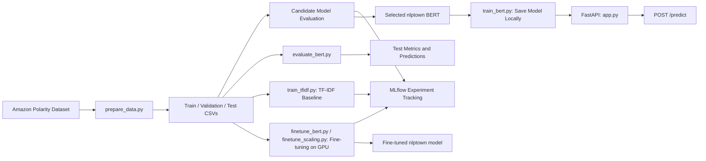

# ReviewPulse

A sentiment analysis service for Amazon product reviews. ReviewPulse prepares a reproducible dataset, evaluates pretrained BERT sentiment models, fine-tunes the selected one, compares it with a TF-IDF baseline, tracks every experiment with MLflow, and serves the selected model through a FastAPI REST API.

**Status:** Milestone 1 — model evaluation, TF-IDF baseline, fine-tuning study and API implementation. See `docs/MILESTONE_1_COMPLETION.md` for the full summary.

## Architecture



The API serves a saved BERT model. Model selection is based on validation-set performance. The held-out test set is reserved for final evaluation. Fine-tuning runs on a GPU (Kaggle); everything else runs on a CPU.

## Technology Stack

- **Language:** Python 3.11
- **Data processing:** pandas, NumPy, Hugging Face Datasets
- **Machine learning:** scikit-learn, PyTorch, Transformers (fine-tuning needs a GPU; the Kaggle notebooks install what they need)
- **Experiment tracking:** MLflow
- **API:** FastAPI, Pydantic, Uvicorn
- **Testing and code quality:** pytest, Ruff

## Quick Start

### 1. Clone the repository

```bash
git clone https://github.com/Kashish598/ReviewPulse.git
cd ReviewPulse
```

### 2. Create and activate a virtual environment

```bash
python -m venv .venv
```

Windows:

```bash
.venv\Scripts\activate
```

macOS/Linux:

```bash
source .venv/bin/activate
```

### 3. Install dependencies

```bash
python -m pip install -r requirements.txt
```

### 4. Prepare the dataset

```bash
python -m src.prepare_data
```

This downloads the Amazon Polarity dataset from Hugging Face, cleans the review text, creates the train, validation, and test splits, and writes the processed files to `data/processed/`.

### 5. Save the selected model locally

```bash
python -m src.train_bert
```

This downloads the selected pretrained model and tokenizer and saves them under `models/nlptown_sentiment/`. This step does **not** fine-tune the model.

### 6. Run the API

```bash
python -m uvicorn src.app:app --reload
```

Open the interactive API documentation at:

[http://127.0.0.1:8000/docs](http://127.0.0.1:8000/docs)

### 7. Run tests and lint checks

```bash
python -m pytest -v
python -m ruff check .
python -m ruff format --check src tests
```

## Dataset and Task

- **Dataset:** [`fancyzhx/amazon_polarity`](https://huggingface.co/datasets/fancyzhx/amazon_polarity)
- **Task:** Binary sentiment classification.
- **Labels:** `0` = negative, `1` = positive.
- **Model input:** The review `content` field. The `title` field is not used.
- **Random seed:** `42`.
- **Dataset revision:** Pinned in `src/common.py` to support reproducibility.

### Dataset Splits

| Split | Number of reviews | Purpose |
|---|---:|---|
| Training | 10,000 (up to 40,000 for the data-size study) | Trains the TF-IDF baseline and the fine-tuned BERT; the pretrained BERT candidates do not use it |
| Validation | 1,000 | Candidate model selection |
| Test | 600 | Final held-out evaluation |

Training and validation examples are sampled from the official training split. Test examples are sampled from the official test split.

Sampling is not stratified. The data preparation pipeline removes missing or empty reviews, removes exact duplicates before sampling, and excludes test-pool reviews that also occur in the training pool. Text is otherwise preserved, including casing, punctuation, stop words, and emojis.

For the data-size study, `python -m src.finetune_scaling prepare` adds up to 30,000 more training reviews from the rest of the official training split (duplicates removed, nothing that occurs in validation or test). The original 10,000 reviews are always the first rows, so the 10,000, 20,000 and 40,000 training sets are nested. Validation and test never change.

The dataset files are generated locally and are not required to be committed to the repository. The pinned dataset revision and random seed are used to make the preparation process reproducible.

## Model Selection

Three pretrained sentiment-analysis checkpoints were evaluated on the same validation set. Macro-F1 was the primary selection metric; accuracy was used as a secondary metric.

| Candidate | Validation Accuracy | Validation Macro-F1 |
|---|---:|---:|
| DistilBERT (`distilbert-base-uncased-finetuned-sst-2-english`) | 0.8910 | 0.8909 |
| RoBERTa (`cardiffnlp/twitter-roberta-base-sentiment`) | 0.8970 | 0.8969 |
| **nlptown BERT (`nlptown/bert-base-multilingual-uncased-sentiment`)** | **0.9300** | **0.9298** |

The nlptown checkpoint was selected because it achieved the highest validation accuracy and macro-F1 among the evaluated candidates.

The selected checkpoint is a pretrained five-star sentiment model. ReviewPulse maps its output to binary sentiment labels as follows:

- 1, 2, and 3 stars → `negative`
- 4 and 5 stars → `positive`

The pretrained model is used as is for the candidate comparison and the first test evaluation. It is then fine-tuned (see Fine-Tuning below).

### MLflow Tracking

Experiments are tracked with MLflow:

| Experiment | Contents |
|---|---|
| `reviewpulse-bert-candidates` | The three candidate runs from `notebooks/bert_candidate_selection.ipynb` (Kaggle GPU), kept in the original Kaggle database `notebooks/kaggle_mlflow.db`. |
| `reviewpulse-bert` | The same three candidate runs copied into the repository's experiment (tag `source=kaggle_mlflow_db`), the run logged by `python -m src.train_bert`, and the fine-tuning runs (`finetune_<recipe>`, `finetune_selected_<recipe>`, `scale_n<size>_seed<seed>`, `scaling_selected_<run>`). |
| `reviewpulse-tfidf` | One run per TF-IDF classifier plus one for the selected model. |

Each candidate run records the model checkpoint, label-mapping policy, truncation setting, maximum sequence length (512) and the validation accuracy and macro-F1. `docs/mlflow_runs_summary.csv` is an export of the runs in `reviewpulse-bert`, including the three candidates, with their parameters, metrics and run IDs.

MLflow 3 no longer accepts the old `./mlruns` folder as a tracking location, so use a database backend. Set the tracking URI before running any script that logs to MLflow, and use the same value for `mlflow ui`.

Windows (PowerShell):

```powershell
$env:MLFLOW_TRACKING_URI = "sqlite:///reviewpulse_mlflow.db"
mlflow ui --backend-store-uri sqlite:///reviewpulse_mlflow.db
```

macOS/Linux:

```bash
export MLFLOW_TRACKING_URI=sqlite:///reviewpulse_mlflow.db
mlflow ui --backend-store-uri sqlite:///reviewpulse_mlflow.db
```

The candidate runs were logged with MLflow 3.18.0, the version used by the project. The fine-tuning runs were logged on Kaggle, in `finetune_mlflow.db` and `scaling_mlflow.db`. Copy them into your local database with `scripts/merge_mlflow_runs.py`, which keeps each run's name, times, params and full epoch-by-epoch metric history (it does not copy the small files logged as artifacts, which are in `scaling_results.zip`). The source database is only read, and a run that was already merged is skipped, so running it twice is safe.

```bash
cp reviewpulse_mlflow.db ../reviewpulse_mlflow.backup.db       # back up first (PowerShell: Copy-Item)
python scripts/merge_mlflow_runs.py scaling_mlflow.db --dry-run  # list the runs, change nothing
python scripts/merge_mlflow_runs.py scaling_mlflow.db            # merge into reviewpulse-bert
python scripts/merge_mlflow_runs.py finetune_mlflow.db           # the first study's three recipes
mlflow ui --backend-store-uri sqlite:///reviewpulse_mlflow.db
```

MLflow databases and run artifacts are generated locally and are not committed. `docs/mlflow_runs_summary.csv` is a snapshot; re-export it after merging if it should include the fine-tuning runs. The validation metrics above and the CSV files in `docs/` are the reported comparison results.

## Held-Out Test Evaluation

The selected nlptown BERT model was evaluated once on the held-out test set of 600 reviews. These examples were not used for candidate selection or model tuning.

| Metric | Result |
|---|---:|
| Accuracy | 0.9283 |
| Macro-F1 | 0.9282 |
| Correct predictions | 557 / 600 |

### Classification Report

| Class | Precision | Recall | F1-score | Support |
|---|---:|---:|---:|---:|
| Negative | 0.91 | 0.96 | 0.93 | 302 |
| Positive | 0.95 | 0.90 | 0.93 | 298 |

### Confusion Matrix

Rows represent actual labels; columns represent predicted labels.

| Actual / Predicted | Negative | Positive |
|---|---:|---:|
| Negative | 289 | 13 |
| Positive | 30 | 268 |

The model correctly classified 557 of the 600 test reviews. The final test accuracy was 92.8%, with a macro-F1 score of approximately 0.9282. A 95% confidence interval for the accuracy is roughly 90.8% to 94.9%. The model misses positive reviews (30) more often than negative ones (13), which is consistent with treating 3-star reviews as negative.

### Reproduce the Test Evaluation

After preparing the data and saving the model locally, run:

```bash
python -m src.evaluate_bert
```

The evaluation script runs inference on the held-out test split and saves `bert_test.csv` (predictions) and `bert_test_metrics.json` (accuracy, macro-F1 and confusion matrix) under `data/predictions/`. The test split should be evaluated once, with the final configuration.

## TF-IDF Baseline

A classical baseline is trained on the same data splits as the BERT models, so the two can be compared fairly. It uses TF-IDF features with one of three classifiers (linear SVM with calibrated probabilities, multinomial Naive Bayes, random forest). All three are fitted on the 10,000 training reviews, the best one is chosen on the 1,000 validation reviews (macro-F1, then accuracy), and only that model is scored on the 600 test reviews, once. It runs on a CPU and needs no GPU.

```bash
python -m src.train_tfidf               # trains, selects, saves the model, scores the test set
python -m src.train_tfidf --no-mlflow   # same, without MLflow tracking
```

Outputs:

- `models/tfidf_v1/` — `model.joblib` and `metadata.json` (not committed).
- `data/predictions/tfidf_test.csv` — row-by-row test predictions, in the same format as `bert_test.csv`.
- `data/predictions/tfidf_test_metrics.json` — test metrics of the selected model.
- MLflow experiment `reviewpulse-tfidf` — one run per candidate classifier (validation metrics, fit time, tags) plus one run for the selected model.

Selected model: linear SVM.

| Model | Validation accuracy | Validation macro-F1 | Test accuracy | Test macro-F1 | Test errors (of 600) |
|---|---:|---:|---:|---:|---:|
| TF-IDF + linear SVM | 0.8730 | 0.8730 | 0.8683 | 0.8683 | 79 |
| nlptown BERT (no fine-tuning) | 0.9300 | 0.9298 | 0.9283 | 0.9282 | 43 |
| nlptown BERT, fine-tuned (40,000 reviews, seed 43) | 0.9520 | 0.9520 | 0.9517 | 0.9517 | 29 |

TF-IDF confusion matrix on the test set (rows are the true label, columns the prediction): `[[266, 36], [43, 255]]`. On the same 600 reviews, the pretrained BERT made 36 fewer errors than the baseline and the fine-tuned model 50 fewer. Both models use the same split and seed, so the comparison is like for like. A row-by-row paired test needs `tfidf_test.csv`.

`MLFLOW_TRACKING_URI` should be set the same way as for BERT (see MLflow Tracking above), so both experiments are stored in the same database.

## Fine-Tuning

The selected nlptown model was fine-tuned on the training split, on a GPU (Kaggle, 2 × T4). Both scripts are in `src/`; the Kaggle notebooks in `notebooks/` run them end to end and log to MLflow.

**Method.** The 5-star output layer is kept. The training loss is the negative log-likelihood of the *mapped binary* probability (1–3 stars against 4–5 stars, computed with a log-sum-exp over the stars), so training matches how the model is scored and the saved model stays a drop-in replacement. Serving still takes the most likely star and maps it. Training uses AdamW (no weight decay on bias and LayerNorm), a linear warm-up (10%) and decay, gradient clipping at 1.0, fp16 on the GPU, batch size 16, maximum length 256 for training and 512 for evaluation. The best epoch is kept, chosen on validation. The test split is never used to choose anything.

### 1. Three recipes on 10,000 reviews

```bash
python -m src.finetune_bert                 # all three recipes, picks the best on validation
python -m src.finetune_bert --smoke         # tiny end-to-end check
```

| Recipe | Learning rate | Epochs | Best epoch | Validation accuracy | Validation macro-F1 |
|---|---:|---:|---:|---:|---:|
| Pretrained, no fine-tuning | – | – | – | 0.9300 | 0.9298 |
| **`lr1e5_ep2`** | 1e-5 | 2 | 1 | **0.9440** | **0.9440** |
| `lr2e5_ep3` | 2e-5 | 3 | 2 | 0.9380 | 0.9380 |
| `lr3e5_ep3_freeze6` (lower 6 layers frozen) | 3e-5 | 3 | 3 | 0.9330 | 0.9330 |

The three recipes are within 1.1 points of each other, which is inside the noise of a 1,000-review validation set, and one seed cannot say whether 0.944 is typical. The next study checks both.

### 2. Seeds and training size

```bash
python -m src.finetune_scaling prepare                         # builds data/processed/train_extended.csv (40,000 rows)
python -m src.finetune_scaling train --worker 0 --workers 2    # GPU 0
python -m src.finetune_scaling train --worker 1 --workers 2    # GPU 1, at the same time
python -m src.finetune_scaling summarize                       # select on validation, re-score, log to MLflow
```

Recipe `lr1e5_ep2`, three seeds (42, 43, 44) at 10,000, 20,000 and 40,000 training reviews: nine runs. The workers record what they would log; `summarize` replays it into MLflow from one process and keeps the best run (best validation macro-F1) as `models/nlptown_finetuned_v2/`. The test set is scored for every run so the spread between seeds can be reported, and is never used to choose a model.

| Training reviews | Validation accuracy (mean ± std) | Test accuracy (mean ± std) | Test range | Minutes per run |
|---:|---:|---:|---:|---:|
| Pretrained | 0.9300 | 0.9283 | – | – |
| 10,000 | 0.9383 ± 0.0049 | 0.9367 ± 0.0076 | 0.9283–0.9433 | 4.7 |
| 20,000 | 0.9450 ± 0.0026 | 0.9456 ± 0.0025 | 0.9433–0.9483 | 9.3 |
| 40,000 | 0.9507 ± 0.0015 | 0.9439 ± 0.0069 | 0.9383–0.9517 | 18.4 |

**How to read this**

- The mean test accuracy over all nine runs is **0.9420**, 1.4 points above the pretrained model (0.9283). Eight runs beat it and one ties it.
- More data raises validation accuracy steadily (0.938, 0.945, 0.951). On a 600-review test set, 20,000 and 40,000 reviews cannot be told apart: the standard error of one accuracy is about 1 point, as large as the spread between seeds.
- The first single-seed result (0.9433 at 10,000 reviews) is the top of the seed range at that size, so quote the mean over seeds as the headline.
- Averaging the three seeds' probabilities did not help on test (0.943–0.947).

### Selected fine-tuned model

`scale_n40000_seed43` (chosen on validation: accuracy 0.9520, macro-F1 0.9520). Test accuracy **0.9517** (571 / 600; 95% Wilson interval 0.931–0.966), macro-F1 0.9517.

| Actual / Predicted | Negative | Positive |
|---|---:|---:|
| Negative | 288 | 14 |
| Positive | 15 | 283 |

Paired against the other models on the same 600 reviews (exact McNemar test):

| Comparison | Fixed | Broken | p |
|---|---:|---:|---:|
| Pretrained → selected | 19 | 5 | 0.0066 |
| First fine-tuned (10,000, 1 seed) → selected | 10 | 5 | 0.30 |

This p-value is for the best of nine runs, so it is optimistic; the mean over seeds above is the fairer summary. Of the selected model's 29 errors, 22 were also wrong for the pretrained and the first fine-tuned model (mean confidence 0.71), which suggests ambiguous or mislabeled reviews rather than a lack of data.

Outputs: `models/nlptown_finetuned_v2/` (weights, tokenizer, `metadata.json`), `data/predictions/bert_finetuned_v2_test.csv`, `data/predictions/bert_finetuned_v2_test_metrics.json`, and `data/predictions/scaling/` (per-run predictions and probabilities, `runs_table.csv`, `by_size.csv`, `report.json`). Model weights are not committed.

The API currently loads the pretrained model from `models/nlptown_sentiment/`. The fine-tuned model is saved in the same Hugging Face format; serving it means pointing the BERT adapter's model directory at `models/nlptown_finetuned_v2/`.

## API Usage

Start the API:

```bash
python -m uvicorn src.app:app --reload
```

### Health Check

```http
GET /health
```

Returns the API status and the name of the model being served.

### Sentiment Prediction

```http
POST /predict
Content-Type: application/json
```

Example request:

```json
{
  "text": "I absolutely love this product. It works perfectly!"
}
```

The endpoint returns a sentiment prediction and its associated model score. The score is the confidence associated with the model's original star prediction; it should not be interpreted as a calibrated probability of the mapped binary sentiment.

Interactive request and response schemas are available through `/docs`.

## Shared Code (`src/common.py`)

| Component | Purpose |
|---|---|
| `load_split(name, sample=False)` | Loads a prepared dataset split. |
| `compute_metrics(y_true, y_pred)` | Computes macro-F1, accuracy, and confusion matrix. |
| `Predictor`, `Prediction` | Shared interface and prediction representation for model adapters. |
| `write_predictions(...)`, `read_predictions(...)` | Writes and reads prediction CSV files. |
| `MLFLOW_BERT_EXPERIMENT` | Shared MLflow experiment name for BERT experiments. |

Predictions use the columns `row_id`, `label_true`, `pred`, and `score`.

## Repository Layout

```text
ReviewPulse/
├── .github/
│   └── workflows/
│       └── ci.yml
├── data/
│   ├── sample/          # Small test fixtures, if included
│   ├── processed/       # Generated dataset splits
│   └── predictions/     # Generated evaluation predictions
├── docs/                # data_report.json, mlflow_runs_summary.csv, MILESTONE_1_COMPLETION.md
├── notebooks/           # Kaggle notebooks (candidate selection, fine-tuning, seeds and size) and the candidate MLflow database
├── models/              # Locally saved model weights
├── src/
│   ├── app.py
│   ├── common.py
│   ├── prepare_data.py
│   ├── train_bert.py
│   ├── evaluate_bert.py
│   ├── bert_model.py
│   ├── tfidf_model.py
│   ├── train_tfidf.py
│   ├── finetune_bert.py       # three fine-tuning recipes (GPU)
│   └── finetune_scaling.py    # seeds x training size study (GPU)
├── scripts/
│   └── merge_mlflow_runs.py   # copy runs between MLflow databases (one-off tool)
├── tests/
├── README.md
├── CONTRIBUTION.md
├── AI_USAGE.md
├── requirements.txt
└── pyproject.toml
```

Generated dataset splits, model weights, virtual environments, MLflow run artifacts, and local database files should not be committed unless explicitly required for a particular deliverable.

## Team Workflow

- Use descriptive branches such as `feat/...`, `fix/...`, and `infra/...`.
- Open a pull request for changes and obtain approval from another team member before merging into `main`.
- Run Ruff and pytest before pushing changes.
- CI runs the repository's configured lint and test checks.
- Add new dependencies to `requirements.txt` with pinned versions in the same change that introduces them.
- Do not commit API keys, virtual environments, generated model weights, or local MLflow artifact directories.

## Tests

Run the complete test suite:

```bash
python -m pytest -v
```

The tests cover data preparation, shared utilities, the BERT and TF-IDF model adapters, TF-IDF MLflow logging, the FastAPI endpoints, and the pure logic of the two fine-tuning scripts (configs, selection rules, the extended training set, statistics, job splitting, MLflow replay). The tests that need PyTorch are skipped when it is not installed, so CI does not need a GPU; the training itself is checked by the smoke test (`--smoke`) in the Kaggle notebooks.

## Additional Documentation

- `CONTRIBUTION.md` — team responsibilities and contributions.
- `AI_USAGE.md` — disclosure of AI-assisted development and review.
- `docs/MILESTONE_1_COMPLETION.md` — what was delivered in Milestone 1, how it is structured, the results and the known limitations.