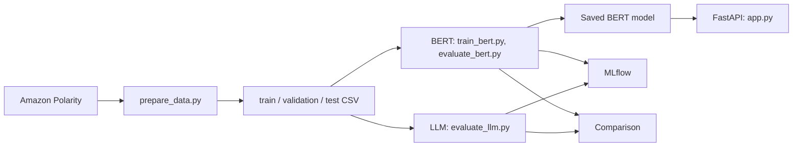

# ReviewPulse

Sentiment analysis service for Amazon product reviews. A BERT classifier is served through FastAPI, and an LLM labels the same held-out reviews for an offline comparison.

Status: Milestone 1 in progress. This README is the single source of truth for the shared decisions below.

## Architecture



The API serves BERT only. The LLM is used for offline evaluation.

## Quick start

Python 3.11.

```bash
git clone <repo-url> && cd ReviewPulse
python -m venv .venv && source .venv/bin/activate   # Windows: .venv\Scripts\activate
make setup        # or: pip install -r requirements.txt
make data         # or: python -m src.prepare_data
make test         # or: pytest -v
make api          # or: uvicorn src.app:app --reload   (docs at http://127.0.0.1:8000/docs)
```

`make data` downloads the dataset from Hugging Face and writes the splits to `data/processed/`. These files are not committed. Seed 42 makes every machine produce the same files, as long as the dataset revision is the same. `DATASET_REVISION` in `src/common.py` pins it, and `/health` on the API reports which model is being served.

## Dataset and task

- Dataset: `fancyzhx/amazon_polarity` (Hugging Face). Binary task, no neutral class.
- Labels: `0` = negative, `1` = positive.
- Model input: the `content` column only. `title` is not used.

## Shared decisions

- Splits: 40,000 train, 10,000 validation, 10,000 test. Seed 42.
- Train and validation are sampled from the official train split. Test is sampled from the official test split.
- No stratification. Plain random sampling. Final label counts are in `docs/data_report.json`.
- Cleaning: remove missing and empty reviews, remove exact duplicates before sampling, remove from the test pool any review that also appears in the train pool. Text is otherwise untouched (casing, punctuation, stop words, emojis kept).
- Metrics: macro-F1 (primary), accuracy and confusion matrix (secondary). BERT vs LLM agreement is reported separately and does not measure correctness.
- Test labels are never used to tune prompts, choose checkpoints or tune hyperparameters. The final configuration is run once on test.
- The LLM never sees gold labels or BERT predictions.

## Shared code (`src/common.py`)

Import these instead of redefining them:

| Name | Use |
|---|---|
| `load_split(name, sample=False)` | Returns `row_id, review_text, label`. `sample=True` reads the small fixture in `data/sample/`. |
| `load_test_subset(n, sample=False)` | First n test rows in a fixed shuffled order. Use it for the LLM, and score BERT on the same rows for the comparison. |
| `compute_metrics(y_true, y_pred)` | Macro-F1, accuracy, confusion matrix. Accepts 0/1 or `negative`/`positive`. Raises on any other value. |
| `Predictor`, `Prediction` | Interface for model adapters: `predict(texts) -> list[Prediction]` with `label` (`negative` or `positive`) and optional `score`. |
| `write_predictions(...)`, `read_predictions(...)` | Predictions CSV with columns `row_id, label_true, pred, score`. |
| `MLFLOW_BERT_EXPERIMENT`, `MLFLOW_LLM_EXPERIMENT` | MLflow experiment names: `reviewpulse-bert`, `reviewpulse-llm`. |

Predictions go to `data/predictions/bert_test.csv` and `data/predictions/llm_test.csv`.

## Repository layout

```
src/            code (prepare_data.py, common.py, app.py, plus each member's scripts)
tests/          pytest files
data/sample/    small fixture, committed
data/predictions/  prediction files, committed
data/processed/ full splits, generated, not committed
models/         model weights, not committed
.github/workflows/ci.yml
```

## Team workflow

- Branch names: `feat/...`, `fix/...`, `infra/...`.
- Open a PR for everything. One approval from another member before merging to `main`. No direct pushes to `main`.
- Run `ruff check .` and `pytest` before pushing. CI runs the same two commands.
- Do not commit data splits, model weights, API keys or `mlruns/`.
- Add each new dependency to `requirements.txt` with a pinned version, in the same PR that needs it.
- Commit an MLflow summary (CSV or screenshot) of your runs, since `mlruns/` is not shared.

## Tests

```bash
pytest -v
```

Covers data preparation, shared utilities and the API. BERT model loading tests and LLM parser tests are added with those components.

## Still to be filled in (later in M1)

MLflow best run and justification, evaluation results, API usage examples, model download instructions, CONTRIBUTION.md, AI_USAGE.md.
